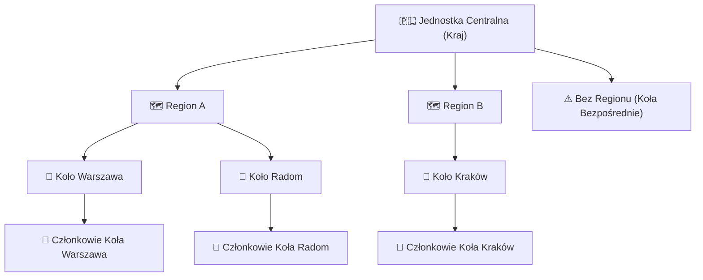
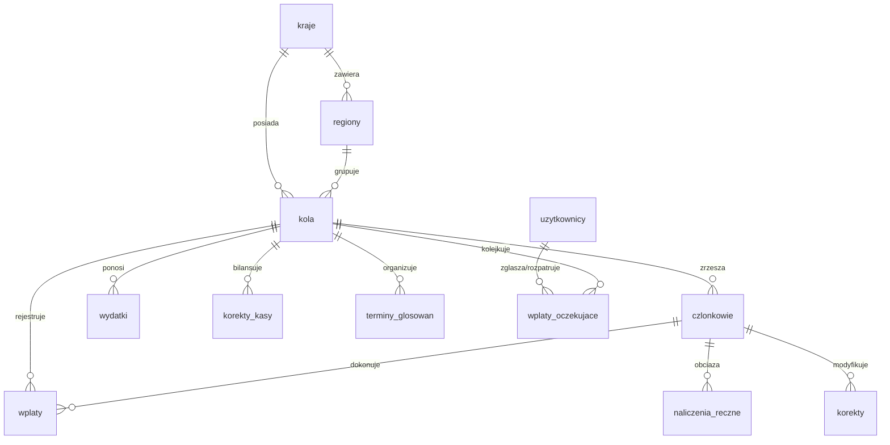
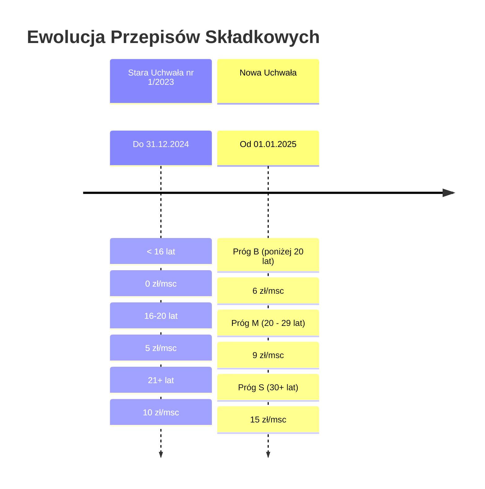
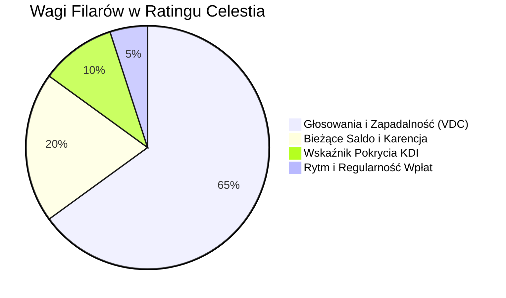

# 🏰 Citadel V3 — Kompletna Dokumentacja Systemu

> **Wersja Systemu**: 3.2.0  
> **Status**: Produkcyjny  
> **Ostatnia aktualizacja**: Październik 2026  
> **Autorzy**: Zespół Rozwoju Citadel (Antigravity & Michał)  

---

## 📑 Spis Treści
1. [Wprowadzenie i Cel Systemu](#-1-wprowadzenie-i-cel-systemu)
2. [Architektura Techniczna i Stos Technologiczny](#-2-architektura-techniczna-i-stos-technologiczny)
3. [Model Danych i Schemat Bazy PostgreSQL](#-3-model-danych-i-schemat-bazy-postgresql)
4. [Zasady Finansowe i Silnik Naliczeń Składek](#-4-zasady-finansowe-i-silnik-naliczeń-składek)
5. [Wskaźnik KDI i Dynamiczny Próg Prawa Głosu](#-5-wskaźnik-kdi-i-dynamiczny-próg-prawa-głosu)
6. [Autorski Silnik Ratingowy Celestia](#-6-autorski-silnik-ratingowy-celestia)
7. [System Kontroli Dostępu i Bezpieczeństwo (RBAC)](#-7-system-kontroli-dostępu-i-bezpieczeństwo-rbac)
8. [Struktura Aplikacji, Widoki i Zakładki](#-8-struktura-aplikacji-widoki-i-zakładki)
9. [Instrukcja Operacyjna Skarbnika (Workflows)](#-9-instrukcja-operacyjna-skarbnika-workflows)
10. [Instalacja, Wdrożenie i Administracja (DevOps)](#-10-instalacja-wdrożenie-i-administracja-devops)

---

## 🏛️ 1. Wprowadzenie i Cel Systemu

**Citadel V3** to zintegrowana platforma webowa klasy Enterprise dedykowana kompleksowemu zarządzaniu finansami, strukturą organizacyjną, dyscypliną płatniczą oraz statutowym prawem głosu w wielopoziomowych organizacjach pozarządowych i stowarzyszeniach.

### 🌐 1.1. Hierarchia Organizacyjna
System odzwierciedla trójstopniową federacyjną strukturę organizacyjną:



### 🎯 1.2. Główne Wyzwania Rozwiązywane przez Citadel V3
1. **Dyscyplina przed głosowaniami**: Automatyczna weryfikacja czy członkowie biorący udział w zebraniach koła i wyborach władz posiadają statutowe uprawnienia do głosu (maksymalne dopuszczalne zadłużenie do 6 miesięcy).
2. **Koniec z błędami zaokrągleń**: Rygorystyczna **Zasada Grosza** (przechowywanie wszystkich kwot jako `BIGINT` w groszach) gwarantuje zerowy błąd sumaryczny w skali wieloletniej.
3. **Odporność na nadużycia scoringowe**: Autorski algorytm **Celestia** weryfikuje wpłaty w dedykowanych oknach zbiórki przed zarejestrowanymi głosowaniami, eliminując zjawisko "symbolicznych wpłat 1 zł" w celu zafałszowania wiarygodności.
4. **Wielopoziomowa analityka w czasie rzeczywistym**: Automatyczna agregacja wskaźników finansowych od pojedynczego członka, przez koło i region, aż po poziom centralny.

---

## ⚡ 2. Architektura Techniczna i Stos Technologiczny

Aplikacja została zaprojektowana w nowoczesnym stosie technologicznym opartym na języku **Python 3.11+**, środowisku reaktywnym **Streamlit** oraz przemysłowej bazie danych **PostgreSQL**.

| Komponent | Technologia | Zastosowanie / Opis |
| :--- | :--- | :--- |
| **Backend & UI** | Python 3.11+ / Streamlit | Architektura reaktywna, zarządzanie stanem sesji (`st.session_state`), dedykowany routing widoków. |
| **Baza Danych** | PostgreSQL 15+ | Relacyjna baza danych, indeksy unikalne i częściowe, widoki uprawnień, audyt w JSONB. |
| **Driver SQL** | `psycopg` (v3) + `psycopg_pool` | Pula połączeń `ConnectionPool(min_size=1, max_size=5)`, automatyczne zwalnianie zasobów. |
| **Menedżer Pakietów**| Astral `uv` | Błyskawiczny resolver zależności zgodny z PEP 621 (`pyproject.toml`, `uv.lock`). |
| **Wizualizacje** | Plotly / Streamlit-Plotly | Interaktywne wykresy osi czasu salda, wskaźnika KDI i rankingów kół. |
| **Warstwa Prezentacji**| CSS Injection / Bento Grid | Trzy motywy wizualne, kafelki Bento, responsywne tabele ze stylami Pandas. |
| **Jakość i Testy** | `pytest` + `ruff` | Zautomatyzowane testy jednostkowe algorytmów finansowych oraz restrykcyjny linter. |

---

## 🗄️ 3. Model Danych i Schemat Bazy PostgreSQL

Baza danych Citadel V3 stosuje rygorystyczne klucze obce z ograniczeniami `ON DELETE RESTRICT` dla kluczowych danych finansowych oraz `ON DELETE CASCADE` dla danych zależnych.

### 📐 3.1. Diagram Związków Encji (ERD)



### 📋 3.2. Szczegółowy Opis Tabel Systemowych

#### 1. `kraje` i `regiony`
* `kraje (id, nazwa)`: Podstawowa jednostka państwowa (domyślnie ID 1: Polska).
* `regiony (id, kraj_id, nazwa, is_deleted, deleted_at)`: Regiony organizacyjne (np. Mazowsze, Małopolska). Posiadają mechanizm *soft-delete* (`is_deleted = TRUE`).
* **Widok `aktywne_regiony`**: `SELECT * FROM regiony WHERE is_deleted = FALSE;`

#### 2. `kola`
* `kola (id, kraj_id, nazwa, region_id, is_deleted, deleted_at, deleted_by_region_id)`: Podstawowa jednostka samorządowa skupiająca członków.
* **Widok `aktywne_kola`**: `SELECT * FROM kola WHERE is_deleted = FALSE;`
* Indeks częściowy zapobiegający duplikatom aktywnych nazw:
  `CREATE UNIQUE INDEX uq_aktywne_kola_nazwa ON kola(nazwa) WHERE (is_deleted = FALSE);`

#### 3. `uzytkownicy`
* `uzytkownicy (id, login, haslo_hash, salt, imie_nazwisko, rola, kraj_id, region_id, kolo_id, is_active, wymus_zmiane_hasla, sesja_wersja, ostatnie_logowanie, ostatnia_aktywnosc, utworzono_o)`:
  * Role: `ADMIN`, `SKARBNIK_KRAJOWY`, `SKARBNIK_REGIONU`, `SKARBNIK_KOLA`.
  * `sesja_wersja`: Inkrementowana przy zmianie uprawnień/hasła, natychmiastowo unieważnia aktywne tokeny sesji.

#### 4. `czlonkowie`
* `czlonkowie (id, kolo_id, imie_nazwisko, data_urodzenia, data_przystapienia, saldo_startowe_gr, reczny_parametr)`:
  * `saldo_startowe_gr`: Bilans otwarcia w groszach na dzień rejestracji w systemie.
  * `reczny_parametr`: Wartość `'AUTO'` (parametr zależy od wieku) lub stała stawka funkcyjna/specjalna (`'B'`, `'M'`, `'S'`).

#### 5. `wplaty` i `wplaty_oczekujace`
* `wplaty (id, kolo_id, czlonek_id, kwota_gr, data_wplaty, notatka, data_wpisu, idempotency_key)`:
  * Zaksięgowane wpłaty członkowskie lub darowizny na konto koła.
  * `idempotency_key TEXT UNIQUE`: Klucz zapobiegający dwukrotnemu zaksięgowaniu tego samego wyciągu bankowego.
* `wplaty_oczekujace`: Kolejka wpłat zgłaszanych przez skarbników kół wymagająca zatwierdzenia przez Skarbnika Krajowego:
  * `oswiadczenie`: `'MAM_POTWIERDZENIE'` lub `'BRAK_POTWIERDZENIA'`.
  * `status`: `'OCZEKUJE'`, `'ZAAKCEPTOWANA'`, `'ODRZUCONA'`.

#### 6. `naliczenia_reczne` i `korekty`
* `naliczenia_reczne (id, czlonek_id, kwota_gr, data_naliczenia, tytul, data_wpisu)`: Jednorazowe obciążenia członka (np. składka celowa, zjazdowa).
* `korekty (id, czlonek_id, delta_gr, docelowe_saldo_gr, data_korekty, powod, data_wpisu)`: Księgowanie różnicowe salda członka ze ścisłym audytem powodu korekty.

#### 7. `wydatki` i `korekty_kasy`
* `wydatki (id, kolo_id, kwota_gr, data_wydatku, kategoria, opis, data_wpisu)`: Koszty bieżące koła (materiały, sala, delegacje).
* `korekty_kasy (id, kolo_id, delta_gr, docelowy_stan_gr, data_korekty, powod, data_wpisu)`: Inwentaryzacja fizycznej kasy podręcznej koła.

#### 8. `terminy_glosowan`
* `terminy_glosowan (id, kolo_id, data_glosowania, data_zbiorki_od, data_wymagalnosci_do, dni_zbiorki_przed, dni_wymagalnosci_po, nazwa, opis, waga, utworzono_o, utworzono_przez)`:
  * Rejestr zebrań i głosowań stanowiący fundament silnika ratingowego Celestia.

#### 9. `audit_log`
* `audit_log (id, tabela, operacja, rekord_id, stare_dane, nowe_dane, zmieniono_o)`: Pełna historia mutacji rekordów w formacie `JSONB`.

---

## 💰 4. Zasady Finansowe i Silnik Naliczeń Składek

### 🪙 4.1. Zasada Grosza (`BIGINT`)
Wszelkie obliczenia sald, wpłat, wydatków i korekt są dokonywane na liczbach całkowitych reprezentujących **grosze**:
* $1{,}00\text{ PLN} = 100\text{ gr}$.
* Funkcje konwersji w `config.py`:
  ```python
  def gr_na_pln(gr: int) -> float:
      return gr / 100.0

  def pln_na_gr(pln: float) -> int:
      return int(round(pln * 100))
  ```
Nigdy nie wolno przechowywać kwot w bazie jako typy zmiennoprzecinkowe `REAL` / `FLOAT`.

### 📜 4.2. Ewolucja Uchwał Składkowych i Stawki Progresywne

Algorytm naliczeń w `calculations.py` dynamicznie interpretuje historię członkostwa na osi czasu:



* **Członkowie funkcyjni**: Przy ręcznym ustawieniu parametru (np. `'S'`) stawka ta obowiązuje niezależnie od wieku.
* **Data Odcięcia**: Stała `DATA_ODCIECIA = date(2026, 10, 1)` stanowi punkt odniesienia bieżącego okresu rozliczeniowego.
* **Wiek Minimalny**: Członek w momencie przystąpienia musi mieć ukończone co najmniej 13 lat (`waliduj_daty_czlonka`).

### 🧮 4.3. Wzory Matematyczne Rozliczeń Członka

Dla każdego członka $i$ w punkcie czasowym $T$:
1. **Naliczenia całkowite ($N_i$)**:
   $$N_i = \text{Naliczenia\_Auto}_i(T) + \sum \text{Naliczenia\_Ręczne}_i(T)$$
2. **Saldo Aktualne ($\text{Sal}_i$)**:
   $$\text{Sal}_i = \text{Saldo\_Startowe}_i + \sum \text{Wpłaty}_i(T) + \sum \text{Korekty}_i(T) - N_i$$
3. **Miesiące Zadłużenia ($M_i$)**:
   $$M_i = \begin{cases} 0 & \text{jeśli } \text{Sal}_i \ge 0 \\ \frac{|\text{Sal}_i|}{S_i^{\text{bieżąca}}} & \text{jeśli } \text{Sal}_i < 0 \end{cases}$$
4. **Statutowe Prawo Głosu**:
   $$\text{Prawo Głosu} = \begin{cases} \text{TAK} & \text{jeśli } M_i \le 6.0\text{ msc} \\ \text{NIE} & \text{jeśli } M_i > 6.0\text{ msc} \end{cases}$$
5. **Dopłata do zera i dopłata do prawa głosu**:
   $$\text{Dopłata do zera} = \max(0, \, -\text{Sal}_i)$$
   $$\text{Dopłata do głosu} = \max(0, \, |\text{Sal}_i| - 6 \times S_i^{\text{bieżąca}}) \quad (\text{dla } \text{Sal}_i < 0)$$

---

## 📊 5. Wskaźnik KDI i Dynamiczny Próg Prawa Głosu

**KDI (Wskaźnik Pokrycia Zapotrzebowania)** określa bilans wpłat członka względem wymaganych od niego składek:
$$KDI = \frac{\text{Zapotrzebowanie}}{\text{Wpłaty}} = \frac{z_i}{s_i}$$
gdzie:
* $s_i = \max(0, \, \text{Saldo\_Start}_i) + \sum \text{Wpłaty}_i$
* $z_i = \max(0, \, s_i - \text{Sal}_i)$ (łączne wymagane zobowiązanie członka).

### 🎯 5.1. Skala Barwna KDI
Wskaźnik KDI stosuje kanoniczny gradient barwny (wysoki kontrast i neonowa poświata):
* $0.00 - 0.50$: `#16823c` (Głęboki Szmaragd — wybitna nadpłata)
* $0.51 - 1.00$: `#4ade80` (Jasna Zieleń — nadpłata / stan idealny)
* $1.00 - 1.20$: `#ffffff` / `#facc15` (Biel / Żółty — norma statutowa)
* $1.21 - 2.00$: `#f97316` (Pomarańczowy — ostrzeżenie)
* $2.01 - 3.00$: `#ef4444` (Czerwony — poważne zadłużenie)
* $3.01 - 5.00$: `#ec4899` (Różowy — utrata prawa głosu)
* $5.01 - 10.0$: `#3b82f6` (Błękitny — krytyczny dług)
* $> 10.0$: `#a855f7` (Głęboki Fiolet — stan terminalny)

### ⚖️ 5.2. Geneza Benchmarku 1.20 a Rzeczywisty Próg Prawa Głosu

W oficjalnej dokumentacji i na kafelkach Bento znajduje się stały benchmark:
$$\text{Rekomendowane: } \le 1.20$$

> [!NOTE]
> **Dlaczego dokładnie 1.20?**  
> Wartość 1.20 wynika wprost z matematyki statutu dla modelowego, 3-letniego stażu członka ($36$ miesięcy) przy dopuszczalnym 6-miesięcznym długu ($30$ miesięcy opłaconych):
> $$KDI = \frac{36 \times S}{30 \times S} = \frac{36}{30} = \mathbf{1.20}$$

W rzeczywistości próg KDI gwarantujący prawo głosu **jest dynamiczny i zależy od stażu członka**:
$$s_i^{\min} = \max(0, \, z_i - 6 \times S_i)$$

* **Staż $\le 6$ miesięcy**: $s_i^{\min} = 0 \implies$ **pełna karencja** (członek może głosować nawet bez wpłaty ani jednej złotówki!).
* **Staż 7 miesięcy**: $z=7S, \, s^{\min}=1S \implies KDI_{\text{próg}} = \frac{7}{1} = \mathbf{7.00}$.
* **Staż 36 miesięcy (3 lata)**: $z=36S, \, s^{\min}=30S \implies KDI_{\text{próg}} = \frac{36}{30} = \mathbf{1.20}$.
* **Staż 60 miesięcy (5 lat)**: $z=60S, \, s^{\min}=54S \implies KDI_{\text{próg}} = \frac{60}{54} \approx \mathbf{1.11}$.

### 🏛️ 5.3. Agregacja Dynamicznego Progu dla Koła, Regionu i Kraju
Dla grupy członków próg KDI obliczany jest na podstawie sumy zapotrzebowania i sumy minimalnych wpłat:
$$KDI_{\text{próg\_grupy}} = \frac{\sum z_i}{\sum \max(0, \, z_i - 6 \times S_i)}$$

W kafelkach Bento wartość jest prezentowana w formacie:
`1.15` <span style="font-size: 0.92rem; font-weight: 600; color: #facc15; text-shadow: 0 0 10px #facc15;">(próg: ≤ 1.25)</span>  
z niezmienionym podtytułem: `Rekomendowane: ≤ 1.20`.

---

## 🛡️ 6. Autorski Silnik Ratingowy Celestia

**Celestia** to autorski algorytm scoringowy (skala 0–1000 pkt) badający rzeczywistą dyscyplinę płatniczą członków w kluczowych momentach życia organizacji — podczas zebrań i głosowań koła.

### 🌟 6.1. 12-Stopniowa Skala Ratingowa

| Klasa | Kod | Zakres Pkt | Profil Ryzyka | Charakterystyka Zachowania |
| :--- | :--- | :---: | :--- | :--- |
| **Prime Apex** | `AAA` | 950–1000 | Wzorcowa Wiarygodność | Stała nadpłata lub wpłaty z wyprzedzeniem przed zebraniami. Zero zaległości. |
| **High Grade** | `AA` | 880–949 | Bardzo Wysoka Dyscyplina | Regularne opłacanie składek w oknie zbiórki. Sporadyczne, minimalne poślizgi. |
| **Upper Medium**| `A` | 800–879 | Wysoka Dyscyplina | Solidny płatnik. Zawsze zachowane prawo głosu. Spłata tuż przed zebraniem. |
| **Good Standing**| `BBB`| 700–799 | Dobra Wiarygodność | Drobne zaległości regulowane w oknie zbiórki lub w dniu zebrania. |
| **Moderate** | `BB` | 600–699 | Umiarkowana Regularność | Korzystanie z marginesu karencji (zadłużenie do 6 msc). Spłaty zrywami. |
| **Vulnerable** | `B` | 500–599 | Wrażliwa Dyscyplina | Balansowanie na krawędzi karencji. Spłaty z poślizgiem po monitach. |
| **Substantial Risk**| `CCC`| 380–499| Podwyższone Ryzyko | Zdarzenia wejścia w dzień zebrania z utratą prawa głosu (> 6 msc długu). |
| **Extremely Speculative**| `CC`| 260–379| Wysokie Ryzyko | Chroniczne ignorowanie zbiórek. Długotrwały brak uprawnień do głosu. |
| **Near Default**| `C` | 150–259 | Dług Roczny | Zadłużenie rzędu 8–12 miesięcy (~60–100 zł). Świeża, utrwalona utrata praw. |
| **Insolvency 1**| `D` | 90–149 | Dług Ponadroczny | Zadłużenie 12–18 miesięcy (~100–160 zł). Brak wpłat od ponad roku. |
| **Insolvency 2**| `DD` | 40–89 | Dług Dwuletni | Zadłużenie 18–28 miesięcy (~160–250 zł). Utrwalona bierność dwuletnia. |
| **Terminal Default**| `DDD`| 0–39 | Skrajny Default | Zadłużenie > 28–36 miesięcy (> 350–450 zł). Osoba nieaktywna, całkowity brak wpłat. |

### 🏛️ 6.2. Cztery Filary Scoringowe Celestii



#### Filar 1: Voting Due Compliance (VDC) — Waga: 65%
Kluczowy wyznacznik ratingu: czy członek opłaca składki w oknie zbiórki przed zebraniami koła.
* **Okno zbiórki**: Domyślnie 14 dni przed zebraniem (`dni_zbiorki_przed`).
* **Termin wymagalności (100 pkt)**: Przypada na dzień zebrania (`d_glos`).
* **Dopuszczalny poślizg**: Maksymalnie **3 dni** po zebraniu (`min(dni_po, 3)`).
* **Zabezpieczenie przed wpłatą symboliczną**: Okno poślizgu przyznaje punkty **wyłącznie wtedy, gdy wpłata w poślizgu pokrywa całe zadłużenie do zera** (`saldo_na_glos_gr + wplaty_poslizg_gr >= 0`). Wpłata 1 zł nie ratuje punktacji!
* **Wycena punktowa zdarzenia**:
  * Czyste konto w dniu zebrania: **100 pkt**.
  * Zadłużenie $\le 2$ msc: **80 pkt** (brak wpłaty) / **90 pkt** (spłata w poślizgu).
  * Zadłużenie 2–6 msc: **40 pkt** (brak wpłaty) / **65 pkt** (spłata w poślizgu).
  * Zadłużenie 6–8 msc (utrata głosu): **25 pkt** / **45 pkt**.
  * Zadłużenie 8–12 msc: **15 pkt** / **30 pkt**.
  * Zadłużenie 12–18 msc: **8 pkt** / **20 pkt**.
  * Zadłużenie 18–28 msc: **3 pkt** / **10 pkt**.
  * Zadłużenie > 28 msc: **0 pkt** / **5 pkt**.
* **Współczynnik zanikania w czasie (*time-decay*)**:
  $$W_{\text{czas}} = \exp(-0.0018 \times \text{dni\_od\_głosowania})$$
  Najświeższe zebrania mają największy wpływ na scoring.
* **Uwzględnianie zebrań w toku**: W ratingu uwzględniane są zebrania historyczne, zebrania z aktywnie otwartym oknem zbiórki oraz zebrania nadchodzące w horyzoncie 30 dni.

#### Filar 2: Wskaźnik Pokrycia Zadłużenia KDI — Waga: 10%
* $KDI \le 0.50 \implies 1000\text{ pkt}$
* $0.50 < KDI \le 1.00 \implies 1000 - (KDI - 0.50) \times 400$
* $1.00 < KDI \le 1.20 \implies 800 - (KDI - 1.00) \times 1000$
* $1.20 < KDI \le 2.00 \implies 600 - (KDI - 1.20) \times 500$
* $KDI > 2.00 \implies 50\text{ pkt}$.

#### Filar 3: Bieżące Saldo i Karencja — Waga: 20%
* Saldo $\ge 0 \implies 1000\text{ pkt}$.
* Dług $\le 1\text{ msc} \implies 850\text{ pkt}$.
* Dług $1 - 3\text{ msc} \implies 600\text{ pkt}$.
* Dług $3 - 6\text{ msc} \implies 300\text{ pkt}$.
* **Dług 6 – 36 msc (liniowe wygaszanie)**:
  $$\text{Punkty} = \max\left(0, \, 250 - (M_{\text{długu}} - 6.0) \times \frac{250}{30.0}\right)$$
  Dzięki temu twarde zero następuje dopiero po 36 miesiącach całkowitego braku wpłat.

#### Filar 4: Rytm i Regularność Wpłat — Waga: 5%
Ocena średniego odstępu między wpłatami w dniach:
* $\le 45$ dni (comiesięcznie): **1000 pkt**.
* $46 - 100$ dni (kwartalnie): **850 pkt**.
* $101 - 200$ dni (półrocznie): **650 pkt**.
* $201 - 380$ dni (rocznie): **450 pkt**.
* Bonus $+50\text{ pkt}$ za wpłatę w ostatnich 90 dniach.

### 📊 6.3. Rating Koła = MEDIANA, a nie Średnia
Główny wskaźnik wiarygodności koła jest wyliczany jako **mediana statystyczna** (`statistics.median`) ze scoringów członków:
$$\text{Rating}_{\text{Koła}} = \operatorname{median}(\text{Score}_1, \, \text{Score}_2, \, \dots, \, \text{Score}_n)$$
Średnia arytmetyczna podawana jest wyłącznie pomocniczo. Mediana uodparnia koło na zafałszowanie wyniku przez pojedyncze osoby porzucające organizację.

---

## 🔐 7. System Kontroli Dostępu i Bezpieczeństwo (RBAC)

Moduł [`citadel/rbac.py`](file:///c:/Users/Micha%C5%82/Desktop/Citadel%20V3/citadel/rbac.py) stanowi pojedyncze źródło prawdy (*Single Source of Truth*) dla autoryzacji.

### 🛡️ 7.1. Macierz Uprawnień

| Akcja w Systemie | `ADMIN` | `SKARBNIK_KRAJOWY` | `SKARBNIK_REGIONU` | `SKARBNIK_KOLA` |
| :--- | :---: | :---: | :---: | :---: |
| Przeglądanie całego Kraju (`widzi_kraj`) | ✅ | ✅ | ❌ | ❌ |
| Przeglądanie Regionu (`widzi_region`) | ✅ | ✅ | ✅ | ❌ |
| Bezpośrednie księgowanie wpłat (`bezposrednie_ksiegowanie`)| ✅ | ✅ | ❌ | ❌ |
| Akceptacja wpłat oczekujących (`akceptuje_wplaty`) | ✅ | ✅ | ❌ | ❌ |
| Ręczne naliczenia składek (`reczne_naliczenia`) | ✅ | ✅ | ❌ | ❌ |
| Korekty salda członków (`korekty_salda`) | ✅ | ✅ | ❌ | ❌ |
| Usuwanie członków (`usuwa_czlonka`) | ✅ | ✅ | ❌ | ❌ |
| Zarządzanie strukturą kół i regionów (`zarzadza_struktura`)| ✅ | ✅ | ❌ | ❌ |
| Zarządzanie kontami użytkowników (`zarzadza_kontami`) | ✅ | ❌ | ❌ | ❌ |
| Zarządzanie koszem / przywracanie (`zarzadza_koszem`) | ✅ | ❌ | ❌ | ❌ |
| Przeglądanie Dziennika Audytu (`widzi_audyt`) | ✅ | ❌ | ❌ | ❌ |
| Zarządzanie członkami i zebraniami własnego koła | ✅ | ✅ | ✅ | ✅ |

Weryfikacja w kodzie:
```python
if moze(rola_uzytkownika, "akceptuje_wplaty"):
    # Renderowanie panelu akceptacji
```

### 🔒 7.2. Bezpieczeństwo Haset i Sesji
* **Algorytm**: PBKDF2-HMAC-SHA256 z $200\,000$ iteracji.
* **Sól**: Unikalna dla każdego użytkownika generowana przez `secrets.token_hex(16)`.
* **Weryfikacja hasła**: Funkcja `secrets.compare_digest` chroniąca przed atakami typu *timing attack*.
* **Ochrona sesji**: Pole `sesja_wersja` w bazie — modyfikacja uprawnień lub hasła unieważnia aktywne sesje użytkownika w innych przeglądarkach.

---

## 🖥️ 8. Struktura Aplikacji, Widoki i Zakładki

```
citadel/
├── app.py                         # Punkt wejścia Streamlit, autoryzacja, routing
├── config.py                      # Motywy CSS, paleta KDI, strefa czasowa Europe/Warsaw
├── database.py                    # ConnectionPool psycopg3, DDL, zapytania SQL
├── calculations.py                # Silnik naliczeń, KDI, dynamiczny próg, filtry interwałów
├── celestia.py                    # Scoring Celestia, wagi, audyt głosowań, skala AAA-DDD
├── rbac.py                        # Role i macierz moze(rola, akcja)
├── components/
│   ├── ui.py                      # render_bento_card, render_user_pill
│   └── charts.py                  # Wykresy Plotly z adaptacją motywu
└── views/
    ├── view_kraj.py               # Panel Ogólnokrajowy
    ├── view_region.py             # Panel Regionalny
    ├── view_kolo.py               # Kontroler Koła
    └── kolo/                      # Zakładki Koła
        ├── tab_zbiorcza.py        # Tabela Zbiorcza finansów członków
        ├── tab_profile.py         # Profile analityczne, wykresy salda i KDI
        ├── tab_celestia.py        # Terminy zebrań, zbiórki, audyt Celestia
        ├── tab_wplaty.py          # Księgowanie wpłat i import masowy
        ├── tab_reczne.py          # Obciążenia jednorazowe
        ├── tab_kasa.py            # Kasa podręczna koła i wydatki
        ├── tab_korekty.py         # Korekty salda członka
        ├── tab_czlonkowie.py      # Dodawanie, edycja i przenoszenie członków
        ├── tab_kalkulator.py      # Symulator stawek i praw głosu
        ├── tab_akceptacje.py      # Akceptacja wpłat oczekujących
        ├── tab_struktura.py       # Zarządzanie strukturą jednostek
        ├── tab_audyt.py           # Przeglądarka audit_log
        └── tab_centauri.py        # Zaawansowane narzędzia administracyjne
```

### 🎨 8.1. Trzy Spójne Motywy Wizualne
Aplikacja udostępnia dynamiczny przełącznik motywów w pasku bocznym:
1. **Fiolet (Domyślny)**: Głęboki fiolet (`#0b0914`), akcenty neonowe (`#9333ea`, `#c084fc`), fioletowe poświaty kart Bento.
2. **Dark Mono**: Surowy grafit/czerń (`#0e1117`), ramki `#262730`, wysoki kontrast dla pracy nocnej.
3. **Light Mono**: Śnieżnobiałe tło (`#ffffff`), karty `#f8fafc`, obramowania `#e2e8f0`, wysoki kontrast typografii i wykresów Plotly.

---

## 📋 9. Instrukcja Operacyjna Skarbnika (Workflows)

### 👤 9.1. Rejestracja Nowego Członka
1. Przejdź do zakładki **👤 Zarządzaj Członkami**.
2. Wypełnij formularz: Imię i Nazwisko, Data Urodzenia, Data Przystąpienia, Saldo Startowe (PLN).
3. System automatycznie sprawdza walidację wieku (ukończone 13 lat w dniu przystąpienia) oraz brak dat z przyszłości.
4. Kliknij **Dodaj Członka**. System przypisze automatyczny parametr taryfowy na podstawie wieku.

### 📅 9.2. Organizacja Zebrania / Głosowania
1. Przejdź do zakładki **⭐ Celestia & Głosowania**.
2. W sekcji rejestracji podaj:
   * Datę zebrania/głosowania.
   * Długość zbiórki (`dni_zbiorki_przed`, domyślnie 14 dni).
   * Dopuszczalny poślizg (`dni_wymagalnosci_po`, 0–3 dni).
   * Wagę wydarzenia (1.0 = standard, 1.5–2.0 = walne/wybory).
3. Podgląd na żywo natychmiast wyświetla ramy czasowe zbiórki.
4. Po kliknięciu **Zarejestruj Głosowanie**, system włącza zebranie do scoringu Celestii.

### 💳 9.3. Księgowanie Wpłat
* **Skarbnik Koła**:
  1. Przejdź do **💰 Wpłaty Członków**.
  2. Wybierz członka, kwotę i datę.
  3. Zaznacz oświadczenie o posiadaniu potwierdzenia.
  4. Wpłata trafia do kolejki **Wpłat Oczekujących** ze statusem `OCZEKUJE`.
* **Skarbnik Krajowy / Admin**:
  1. Przejdź do zakładki **📥 Akceptacje**.
  2. Sprawdź listę zgłoszonych wpłat.
  3. Kliknij **Akceptuj** (wpłata staje się prawomocna i natychmiast koryguje saldo oraz KDI) lub **Odrzuć** z podaniem uzasadnienia.

### 🛠️ 9.4. Rozliczenie Kasy Podręcznej i Wydatków
1. Przejdź do zakładki **💳 Kasa Koła & Wydatki**.
2. **Rejestracja wydatku**: Wybierz kategorię (materiały, sala, transport), wprowadź kwotę i opis. Kasa koła ulega natychmiastowemu pomniejszeniu.
3. **Korekta stanu kasy**: W przypadku rozbieżności fizycznej gotówki, wprowadź stan docelowy i uzasadnienie. Różnica zostanie zaksięgowana w `korekty_kasy`.

---

## 🚀 10. Instalacja, Wdrożenie i Administracja (DevOps)

### 📦 10.1. Wymagania Systemowe
* **System operacyjny**: Windows 10/11, Windows Server, Linux (Ubuntu 22.04+), macOS.
* **Python**: Wersja `3.11` lub `3.12`.
* **Baza danych**: PostgreSQL `14+` (zalecany PostgreSQL 16 lub Neon Serverless Postgres).
* **Menedżer pakietów**: Astral `uv` (rekomendowany) lub standardowy `pip`.

### ⚙️ 10.2. Krok po Kroku: Instalacja z `uv`
```powershell
# 1. Klonowanie repozytorium
git clone https://github.com/michterion/Citadel-V3.git
cd "Citadel V3"

# 2. Synchronizacja środowiska wirtualnego
uv sync

# 3. Konfiguracja pliku citadel/.streamlit/secrets.toml
# Wprowadź dane dostępowe do bazy PostgreSQL:
[postgres]
host = "localhost"
port = 5432
dbname = "citadel_db"
user = "citadel_user"
password = "TwojeSuperBezpieczneHaslo"
sslmode = "prefer"
```

### 🖥️ 10.3. Uruchamianie Aplikacji
* **Windows (One-Click)**: Kliknij dwukrotnie plik `citadel/Citadel_launch.bat`.
* **PowerShell / Terminal**:
  ```powershell
  uv run streamlit run citadel/app.py
  ```

### 🧪 10.4. Zautomatyzowane Testy i Jakość Kodu
Projekt posiada pełny zestaw testów weryfikujących logikę ratingową i finansową:
```powershell
# Uruchomienie testów jednostkowych (pytest)
uv run pytest

# Kontrola jakości kodu i zgodności z PEP (Ruff)
uv run ruff check citadel
uv run ruff check tests

# Automatyczna korekta bezpiecznych reguł
uv run ruff check citadel --fix
```

### 💾 10.5. Procedura Tworzenia Kopii Zapasowej (Backup)
```bash
# Wykonanie zrzutu bazy danych PostgreSQL do pliku SQL:
pg_dump -h localhost -p 5432 -U citadel_user -F c -b -v -f "citadel_backup_$(date +%Y%m%d).dump" citadel_db

# Przywrócenie bazy z kopii zapasowej:
pg_restore -h localhost -p 5432 -U citadel_user -d citadel_db -v "citadel_backup_20261016.dump"
```

---

> [!IMPORTANT]
> **Poufność Danych i Bezpieczeństwo Produkcyjne**:  
> Plik `secrets.toml` oraz wszelkie wygenerowane zrzuty baz danych (`*.dump`, `*.sql`) podlegają ścisłym regułom pliku `.gitignore`. Nigdy nie publikuj haseł bazodanowych ani certyfikatów SSL w publicznych gałęziach repozytorium.
